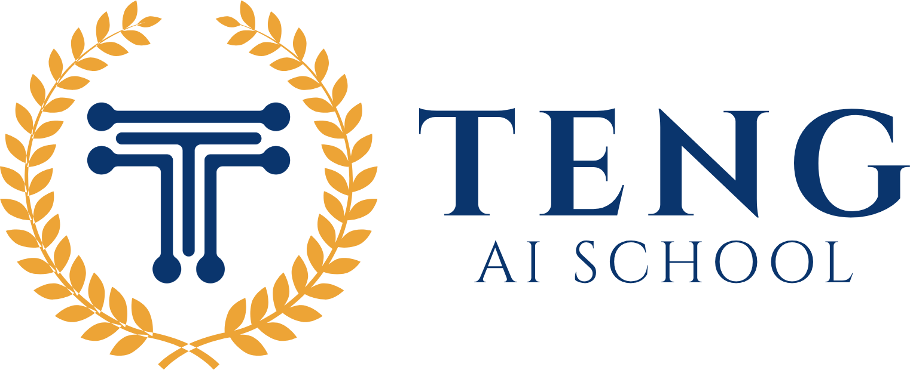

# Social Cut Kit 2.1



Eight TENG AI SCHOOL Skills For Turning A Brief, A Recording, Or An Animation Idea Into An Editable Social Video. The Kit Includes A Local Footage Editor, An Offline Motion Studio, An Asset Library, And An Example You Can Open Before Installing Any Skills.

New Here? Read The [Start Here Sheet](START-HERE.md) First. It Shows What To Install And Which Skill To Ask For.

## Try An Edit

Unzip The Download. In A Terminal At The Product Root, Run The Following With Python 3.10 Or Later. The Footage Editor Uses FFmpeg And FFprobe From Your System Path.

```sh
python skills/video-edit/scripts/edit_video.py review examples/repair-desk/timeline.json
```

An Eight-Second Vertical Edit Opens In Your Browser. Scrub Across The Three-Second Mark To See The Filter Change And Hear The Confirmation Cue. Edit A Caption Or Cut Point, Save The Timeline, And Play It Again. The Source Is An Included [Fictional Repair Queue](examples/repair-desk/demo.html). [Example Project](examples/repair-desk/README.md)

For Animation, Open [Motion Studio](skills/animated-video/studio/index.html) From The Unzipped Folder. Try A Kinetic Title, A Process Diagram, Or A Lit 3D Turntable. The Browser Opens The Included Scene Without A Package Install. For Reusable Visuals, Open The [Icon And Overlay Gallery](art/index.html).

To Continue In A Production Application, Take A Saved Storyboard Into [Remotion](skills/animated-video/adapter/README.md), Or Open The Included [Pulse Dial Blender Scene](skills/animated-video/blender/Pulse%20Dial.blend) To Edit Its Materials, Lighting, Camera Move, And Animated Controls.

## Install The Skills

Choose The Command For Your Agent. Replace `python` With `python3` On Systems That Use That Name. Restart Or Reload The Agent After Installation.

```sh
python install.py --agent codex
python install.py --agent claude
```

To Install Specific Skills, Append Their Folder Names. For Example, `python install.py --agent codex director video-edit` Installs The Shot Planner And Editor. Existing Same-Name Folders Are Skipped By Default. When Upgrading From An Earlier Edition, Run `python install.py --agent codex --upgrade` Or Its Claude Equivalent. This Backs Up Each Replaced Folder Beside The Agent’s Skills Directory And Prints The Backup Location.

## Pick A Starting Point

| Task | Tool | First Result |
| --- | --- | --- |
| Define An Offer And Its Proof | [Campaign Brief](skills/teng-campaign-brief/SKILL.md) | A Structured Brief With Sources, A Viewer Action, And A Measurable Response |
| Write A Short And Read Its Analytics | [Script Desk](skills/video-script/SKILL.md) | Ideas, A Timed Script With A Checklist, And A Posted-Video Review Backed By Your Own Video Library |
| Plan Pictures And Sound | [Director’s Desk](skills/director/SKILL.md) | An Offline Shot Board And A Timeline Built From Sourced Beats |
| Cut Recorded Footage | [Video Edit](skills/video-edit/SKILL.md) | A Local Editable Timeline With Source Sound, Overlays, Captions, And Speed Changes |
| Build An Animated Explainer | [Animated Video](skills/animated-video/SKILL.md) | A Reopenable Storyboard Or A Code-Drawn Film Timed From The Voiceover And Reviewed From Stills |
| Find Or Reuse A Project Asset | [Asset Library](skills/asset-library/SKILL.md) | A Searchable Local Record With Source Rights And Exact Version Pins |
| Review A Finished Session Or A Cut | [Reflect](skills/reflect/SKILL.md) | Evidence-Based Findings And Proposed Instruction Changes That Wait For Your Approval |
| Test A Better Skill, Instruction, Or Method | [Workflow Trials](skills/rsi/SKILL.md) | A Bounded Before-And-After Experiment With A Measurable Improvement Threshold |

## Camera Motion, Resolve, And Publishing

| You Want To | Start Here |
| --- | --- |
| Give A Second Clip The Camera Movement Of A Reference | Install NumPy And OpenCV, Then [Measure And Review The Move On The Target Clip](skills/video-edit/CAMERA.md) |
| Hand An Editor A Native Resolve Timeline With Separate Tracks | Open The Destination Project In Resolve Studio 21.1 Or Later And [Build Its Editable Tracks](skills/video-edit/RESOLVE.md) |
| Publish An Approved Master Or Reserve A Specific Time | [Prepare The Post, Submit Through The Authorized Account, And Verify The Receipt Or Queue Entry](skills/video-edit/PUBLISH.md) |

The Video Editor Also Exposes These Workflows As `camera`, `resolve`, And `post`. Run `python skills/video-edit/scripts/edit_video.py camera --help` From The Product Root Or Substitute The Workflow You Need.

## Work With Your Footage

- Inspect A Source, Find Silences And Scene Changes, And Assemble Selected Takes In Timeline Order. Use The Original Recording For Speech And Keep Audio Handles On The Cut.
- Transcribe With A Separately Installed Local Recognizer, Or Import Existing Word Timings, SRT, Or WebVTT. The Caption Mapper Follows Trims, Handles, Repeated Shots, And Speed Changes. [Speech Tools](skills/video-edit/SPEECH.md)
- Track A Single Detail To Study A Shot, Or Transfer Its Overall Pan, Zoom, And Rotation To A Second Clip. [Reference And Take Tools](skills/video-edit/RECREATION.md) · [Camera Motion Transfer](skills/video-edit/CAMERA.md)
- Build A Transparent Title With A Highlighted Keyword, Or Add One Of The 63 Original Sound Cues Across The Footage And Animation Tools. [Title Overlays](skills/video-edit/TITLES.md) · [Editorial Cues](skills/video-edit/assets/cue-bank/README.md)
- Build Directly In Resolve When That Is The Delivery Editor. For Interchange With Other Editors, The Kit Also Writes OTIO And SRT. [Native Resolve Assembly](skills/video-edit/RESOLVE.md)
- For School Productions, Let The Owner Personally Review The Saved Edit In Its Editor Before Any Video Export. A Source Check Or Still Image Can Help Diagnose An Issue During Preparation.

## What The Download Contains

The Code, Skill Instructions, Editing Example, Procedural Sounds, And Vector Art Were Built For This Edition. The Logo Is TENG AI SCHOOL’s Supplied Artwork. FFmpeg, FFprobe, Optional Transcription Models, And Optional Production Applications Are Installed Separately. Purchasers Can Use The Included Assets In Their Own And Their Clients’ Commercial Videos. [Usage Terms](USAGE.md)

| Included Assets | How They Were Made |
| --- | --- |
| 96 Animated Icons And Six Animated Overlays | Hand-Authored Vector Geometry And Hover Motion In The [Icon Library](art/README.md) |
| 56 Editorial WAVs | Seeded Synthesis From The [Cue Bank Generator](skills/video-edit/assets/cue-bank/build.py) |
| Seven Motion Studio WAVs, Six Marks, And Two Overlays | Procedural Sound And Original Drawing Instructions In The [Motion Asset Builder](skills/animated-video/tools/build-assets.cjs) |
| Two Repair Queue Stills | Captured From The Two Filter States Of The Included [Demo](examples/repair-desk/demo.html) |

Run `python checks/test_pipeline.py` For A Local Test Of The Brief, Storyboard, Timeline Handoff, Caption Mapping, Retention Analysis, Audio Alignment, And Installer. The Checks Use Temporary Files And Do Not Export A Video.
