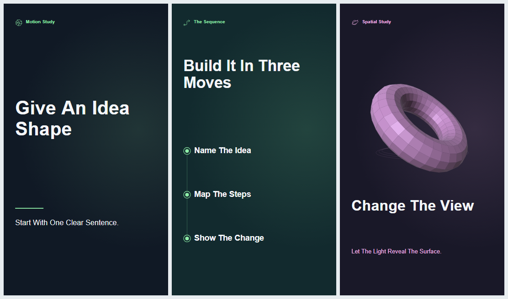

# Animated Video

Two Routes Share One Storyboard Format. For A Quick Title, Process Diagram, Or Turntable, Use Motion Studio's Built-In Scenes, Described From **Motion Studio** Onward. For A Film Drawn To A Brief, Follow **Make A Film In Code**. To Cut Recorded Camera Footage, Use The Video Edit Skill Instead.

Before Anything Else, Read The User's Saved Defaults In `~/.social-cut-kit/animated-video.md` When That File Exists. The User's Stated Preferences, There Or In The Conversation, Come Before This Kit's Defaults.

## Make A Film In Code

**Where A Film Lives.** Each Film Has Its Own Folder In The User's Project, Never Inside The Skill Folder. The Bundled Examples Are Read-Only Starting Points. Copy One Out And Work On The Copy. The Tools Refuse To Write Inside The Skill Folder.

**One Storyboard.** Edit `storyboard.json`. The Timing Tool Builds `storyboard.timed.json` From It, With Every Time Resolved And Every Event Sound In Place. That Timed File Is The Only One To Check, Prepare For Remotion, Review, And Export. Never Edit It By Hand.

**Who Reviews Where.** The Agent Draws, Times, And Checks Stills With The Tools And Motion Studio. The Owner's Approval Review Happens In Remotion Studio. Motion Studio Is The Owner's Review Route Only When Node.js Packages Cannot Be Installed.

Each Step Below Needs Only What The Steps Before It Produced.

1. **Settle The Brief.** Read What The Owner Supplied. Ask What Is Missing In One Message, Each Question With A Recommendation: The One Sentence, The Audience, The Destination With Its Frame And Length, Story Or Explainer, And Whether A Voice Is Recorded, Will Be Recorded, Or Will Never Exist. Have The Format Confirmed. Nothing Is Drawn Yet. [Directing](DIRECTING.md)
2. **Set Up The Film Folder.** Create The Folder In The User's Project. Save The Script There, Or Draft One From The Brief For The Owner To Approve With The Plan. Make Word Timings From The Recording When One Exists, Or Stand-In Timings From The Script When It Is Still To Come. Write A First Storyboard With The Frame, Frame Rate, And Safe Area. A Film That Will Never Have A Spoken Voice Declares That Instead. [Voice Timing](VOICE-TIMING.md) And [Code Scenes](CODE-SCENES.md)
3. **Find The Film.** Search For The Pictures, Write The Beat Sheet With Times Taken From The Word Timings, And Stop For The Owner's Approval Of The Plan. Before That Approval, Only Rough Direction Stills May Be Drawn: Plain Shapes In One Flat Treatment, For The Two Or Three Beats That Carry The Film. No Finished Scene, Motion, Texture, Caption Styling, Or Sound Is Built Yet. [Directing](DIRECTING.md)
4. **Choose The Look From Stills.** Render One Beat In The Offered Styles And Let The Owner Pick. Show As Many Frames As The Owner Asked For. For A Short Film, This Stop May Share One Message With The Plan Stop, And Each Still Needs Its Own Explicit Yes. [Style Frames](STYLE-FRAMES.md) And The Guides In [The Styles Folder](styles/)
5. **Draw The Scenes.** Only After The Plan And The Look Are Both Approved, Write Scene Modules With The Drawing Kit, And Use Or Restyle A Globe, Phone, Character, Or Chart Where It Is The Right Picture. Run The Timing Tool After Each Change. [Code Scenes](CODE-SCENES.md) And [Parts](PARTS.md)
6. **Check From Stills And Numbers.** Render Boards And Frame Strips, Measure Motion, Check Determinism, List The Picture Events And Their Sounds, And Measure The Sound Mix. No Video Is Written. [Review Tools](REVIEW-TOOLS.md)
7. **Judge It.** Read Motion From Strips, Use Independent Judges, And Run The Silent Viewing Test. [Review](REVIEW.md)
8. **Retime To The Real Voice.** When The Recording Arrives, Get Its Word Timings, Run The Timing Tool Again, And Repeat The Checks. A Film On Stand-In Timing Cannot Be Exported. The Preparation Step Warns About It, And Both Export Routes Refuse It. [Voice Timing](VOICE-TIMING.md)
9. **Hand The Film To The Owner In Remotion Studio.** Prepare A Remotion Project From `storyboard.timed.json`. The Owner Opens It In Remotion Studio, Watches The Whole Cut With Sound, And Approves It Before Any Video Is Exported. That Includes Test And Preview Exports. See **Review And Export With Remotion** Below.
10. **Export After Approval, Then Check The File.** The Owner Runs The Reviewed Render. Check The Exported File Against The Storyboard With The Export Check, Then Report. [Review](REVIEW.md)

For A Revision To A Finished Film, Or An Animated Insert For A Camera Edit, Follow [Handoffs](HANDOFFS.md). When A Filmed Presenter Appears Inside The Film, Plan It From The Start With [Presenter](PRESENTER.md).

Run These From The User's Project Folder. `$SKILL` Stands For The Path To This Skill Folder, And `my-film` Is The Film Folder. Set `$SKILL` Once As A Shell Variable, Or Write The Real Path In Its Place. The Same Command Lines Then Work In POSIX Shells And In PowerShell.

~~~sh
SKILL="/path/to/skills/animated-video"
~~~

~~~powershell
$SKILL = "C:/Path/To/skills/animated-video"
~~~

~~~sh
node "$SKILL/tools/standin-words.cjs" my-film/script.txt my-film/words.json
node "$SKILL/tools/retime.cjs" my-film/storyboard.json my-film/words.json my-film/storyboard.timed.json --overwrite
node "$SKILL/tools/stills.cjs" my-film/storyboard.timed.json my-film/board --browser "/path/to/chrome" --half --every 1 --overwrite
node "$SKILL/tools/motion.cjs" my-film/storyboard.timed.json --browser "/path/to/chrome" --determinism
node "$SKILL/tools/events.cjs" my-film/storyboard.timed.json
node "$SKILL/tools/audio.cjs" my-film/storyboard.timed.json
~~~

The Tools Use Node.js And Its Standard Library. The Still And Motion Tools Use A Local Chromium Browser, And The Sound Tools Use FFmpeg From PATH. [An Idea Travels](examples/an-idea-travels/storyboard.json) Is A Complete Small Film To Study, And [First Code Scene](examples/first-code-scene/storyboard.json) Is The Smallest One To Copy Into The User's Project.

## Motion Studio

Open [Motion Studio](studio/index.html) In A Desktop Browser. The Editor Runs Directly From The Extracted Folder. Its Scripts, Meshes, Marks, And Synthesized Sounds Are Local. Use **Save Storyboard** To Download An Editable JSON File. Browser Refresh Starts A New Demo.

## Choose A Starting Point

| Starting Point | Use It For |
| --- | --- |
| [Give An Idea Shape](examples/give-an-idea-shape.json) | Build A Portrait Explainer From A Kinetic Hook, A Three-Step Sequence, And An Orbiting Ring. This Is Also The Initial Demo. |
| [Facet Turntable](examples/facet-turntable.json) | Stage Two Landscape Object Studies With Different Meshes, Surface Finishes, Camera Angles, And Audio Cues. |

Select **Open Storyboard** To Load Either Example Or A Previously Saved JSON File. For A Film With Scene Modules, Select **Open Film Folder** And Pick The Film's Folder, Or Select The Storyboard And Its Module Files Together. A Film Folder Opens Its `storyboard.timed.json` When It Has One. Set **Frame** To Portrait, Square, Landscape, Or Custom With Any Even Width And Height. Set **Frame Rate** To 24, 30, Or 60 FPS.

## Build The Storyboard

1. Write The One Sentence The Viewer Should Remember. Choose A Single Visible Change For Each Scene.
2. Select A Scene In The Left Column. Set Its Duration, Headline, Mark, Colors, And Text Motion. Use **Add Scene**, **Duplicate**, **Move Up**, **Move Down**, Or **Remove** To Arrange The Cut.
3. Choose **Kinetic Type** For A Headline And Supporting Line. **Word Rise** Staggers Individual Words Upward. **Side Sweep** Moves Each Word In From The Left. **Scale Pulse** Expands Each Word Into Place.
4. Choose **Process Diagram** For Up To Five Steps. Enter One Step Per Line. The Editor Spaces The Nodes Vertically And Reveals Them In Order. On Landscape Frames, It Places The Headline Beside The Diagram.
5. Choose **Code Scene** To Use A Built-In Part Or A Loaded Scene Module. Pick Its Draw Function And Edit Its Parameters As JSON. [Parts](PARTS.md) Lists The Options.
6. Choose **3D Object** For A Prism, Crystal, Or Orbit Ring. Adjust Camera Yaw And Elevation For The Opening Angle. Camera Orbit Sets The Total Camera Travel In Degrees. Object Spin Sets A Separate Rotation Over The Scene. Distance Changes Framing. Set The Key Light’s Color, Yaw, Elevation, And Intensity, Then Adjust The Surface Color And Gloss.
7. Use **Play** For Ordinary In-Editor Playback. Drag The Timeline To Inspect A Frame. Download The Storyboard And Cue Sheet For Handoff.

## Direct A 3D Shot

For A Faceted Crystal, Try A Camera Yaw Of −48°, An Elevation Of 18°, A Distance Of 6.4, A Camera Orbit Of 86°, An Object Spin Of −24°, And Gloss Of 0.84. A Cool Surface Under A Warm Key Light Makes The Changing Highlight Easy To Follow. Open The Landscape Example To Try These Values.

The Renderer Projects Polygon Meshes Through A Perspective Camera And Shades Their Faces Using The Surface Color, A Directional Key Light, A View-Dependent Highlight, And Rim Lighting. The Mesh Selector Offers The Three Built-In Geometries. To Author Another Geometry In Code, Extend The Face Builder In [space.js](studio/space.js) And The Shape List In [project.js](studio/project.js).

## Time Voice And Sound

- Add A **Sound** Cue And Set Its Start Time In Seconds Relative To Its Scene. Use Gain From 0 To 1. Room Air Plays Once For Four Seconds. Add Another Cue Four Seconds Later For A Longer Bed.
- Add A **Voice** Cue, Enter The Spoken Line, And Attach The Speaker’s Recorded Audio. The Script Alone Stays Silent. A Short WAV Is A Portable Input. Other Decoders Depend On The Browser.
- The Project Embeds Attached Audio In Its JSON. Save After Attaching A Recording. Each Cue Ends At The Earlier Of Its Recording End Or Scene End. Extend The Scene To Retain The Whole Spoken Phrase And Its Natural Tail.
- **Download Cue Sheet** Writes A Text Handoff With Absolute Scene Boundaries, Spoken Lines, Sound Names, Cue Start Times, And Recording Status.

## Original Asset Library

All Seven WAV Files Are 48 kHz, 16-Bit, Mono PCM. Their Waveforms Come From The Included Synthesis Code.

| Sound | Length | Suggested Placement |
| --- | ---: | --- |
| [Paper Tap](assets/sounds/paper-tap.wav) | 0.19 Seconds | A Soft Tactile Cut Or A Label Appearing |
| [Glass Point](assets/sounds/glass-point.wav) | 0.82 Seconds | A Reveal Or A Bright Specular Highlight |
| [Air Sweep](assets/sounds/air-sweep.wav) | 0.78 Seconds | A Lateral Transition Or Camera Move |
| [Low Bloom](assets/sounds/low-bloom.wav) | 1.46 Seconds | A Weighted Landing Or Opening Beat |
| [Twin Tick](assets/sounds/twin-tick.wav) | 0.39 Seconds | A Step Marker Or Interface Confirmation |
| [Orbit Rise](assets/sounds/orbit-rise.wav) | 1.32 Seconds | A Rising Title Or Turntable Entrance |
| [Room Air](assets/sounds/room-air.wav) | 4.00 Seconds | A Subtle Tonal Bed With A Periodic Waveform For Looping |

Use The Six Transparent SVG Marks In The Editor Or Import Their Individual Files Into Another Tool. The Set Includes [Aperture](assets/marks/aperture.svg), [Signal](assets/marks/signal.svg), [Focus](assets/marks/focus.svg), [Route](assets/marks/route.svg), [Spark](assets/marks/spark.svg), And [Orbit](assets/marks/orbit.svg).

Two Transparent 1080 × 1920 Overlays Are Included For Compositing In An Editor That Imports SVG Artwork. [Edge Register](assets/overlays/edge-register.svg) Adds Corner Brackets And Side Ticks. [Orbit Contour](assets/overlays/orbit-contour.svg) Places Nested Ellipses In The Lower Corner.

## Review And Export With Remotion

The Owner's Approval Review Happens In Remotion Studio By Default, And Remotion Renders The Finished Video. Motion Studio Is Where The Agent Draws, Times, And Checks Stills. It Is The Owner's Review Route Only When Node.js Packages Cannot Be Installed, As The Next Section Describes. Remotion Needs Node.js And A One-Time Package Install Inside Each Generated Project. That Install Uses The Network And Needs The Owner's Agreement. Remotion Has Its Own License Terms. See The [Remotion Adapter Guide](adapter/README.md).

1. Prepare A Project From `storyboard.timed.json`. Scene Modules, Captions, Placed Event Sounds, And The Voice Recording Transfer. For A Quick Storyboard Built In Motion Studio, Prepare From The Saved Storyboard. The Command Writes An Editable Project And No Video.
2. Read What The Command Prints. It Warns When The Storyboard Uses Stand-In Voice Timing, Declares No Narration, Or Lacks The Event Sounds Its Scenes Declare. Fix The Storyboard And Prepare Again Before The Owner Reviews.
3. Install The Declared Packages Inside The Project, With The Owner's Agreement, And Open Remotion Studio.
4. The Project Owner Opens **MotionStoryboard**, Watches The Entire Cut With Sound, And Checks Word Boundaries, Readability, Framing, And The Timing Of Every Cue. To Change The Cut, Edit The Authored Storyboard Or A Scene Module, Run The Timing Tool Again, Prepare A Fresh Project, And Repeat The Review.
5. Wait For The Owner's Explicit Approval Before Creating Any Video File, Including A Test Render Or Preview Export. A Storyboard On Stand-In Voice Timing Is Not Ready For Export, And The Reviewed Render Refuses It.
6. After Approval, The Owner Runs The Reviewed Render. It Asks For Personal Confirmation And Writes An MP4 To A New File.
7. Check The Exported File Against The Storyboard, And Report What The Check Prints.

~~~sh
node "$SKILL/adapter/prepare-remotion.cjs" my-film/storyboard.timed.json my-film-remotion
cd my-film-remotion
npm install
npm run studio
npm run render-reviewed -- Final-Cut.mp4
cd ..
node "$SKILL/tools/export-check.cjs" my-film-remotion/Final-Cut.mp4 my-film/storyboard.timed.json
~~~

The Remotion Picture Comes From The Same Painter As Motion Studio, So Stills Checked There Match The Render.

## Export From Motion Studio Without Installing Anything

Use This Route Only When Node.js Packages Cannot Be Installed. Give The Owner The Whole Film Folder, And Have Them Open It With **Open Film Folder** So The Timed Storyboard, The Scene Modules, And The Voice Recording Load. For A Quick Storyboard With No Modules, The Saved Storyboard Is Enough. The Owner Selects **Review From Start**, Keeps The Tab Visible, And Watches The Entire Cut With Sound. The Same Approval Rule Applies. Once They Approve The Current Cut, They Check The Review Confirmation And Select **Export Approved Video**. Editing Or Reopening A Storyboard Clears Approval. Motion Studio Keeps Export Off For A Storyboard On Stand-In Voice Timing.

A Desktop Browser With Canvas Stream Capture And WebM Recording Support Records The Approved Cut In Real Time. Keep Its Tab Visible Until The WebM Download Starts. Portrait Output Is 1080 × 1920, Square Is 1080 × 1080, Landscape Is 1920 × 1080, And A Custom Frame Uses Its Own Size. Recording Speed And Frame Delivery Depend On The Device, So Run The Export Check On The Downloaded File.

## Native 3D Product Scenes

For A Native Editable 3D Product Scene, Open [Pulse Dial](blender/Pulse%20Dial.blend) In Blender. Use The [Blender Guide](blender/README.md) To Change Its Materials, Camera, And Animated Parts Or Rebuild It From The Included Geometry Generator.

## Rebuild And Check

The Supplied Editor And Assets Are Ready To Use. These Optional Commands Maintain The Kit Itself, So They Are The Only Ones Run From The Folder Containing This Guide. They Use Node.js And Its Standard Library, And They Are The Only Tools That Write Inside The Skill Folder.

~~~sh
node tools/build-assets.cjs
node tools/make-examples.cjs
node tools/check.cjs
~~~

The Node Check Covers The Storyboard Format, The Drawing Kit, Voice Timing, Captions, Events, The Remotion Painter, And The Determinism Of Every Example Code Scene And Part. It Also Runs The Tools On A Film In A Temporary Folder To Prove That A Prepared Remotion Project Carries Its Event Sounds, That Stand-In Timing Cannot Be Rendered, And That Nothing Writes Into The Skill Folder. It Measures Loudness Only When FFmpeg Is On PATH. It Writes No Video.

Run The Optional Browser Check With A Local Chromium Executable. It Exercises Scene Editing, Voice Import, Playback, Storyboard Save/Open, Review Invalidation, The Stand-In Export Refusal, And Opening A Code Scene Film With Its Module. The Optional Stills Flag Regenerates The Three-Frame PNG Above.

~~~powershell
node tools/check-browser.cjs "C:/Program Files/Google/Chrome/Application/chrome.exe" --stills
~~~
